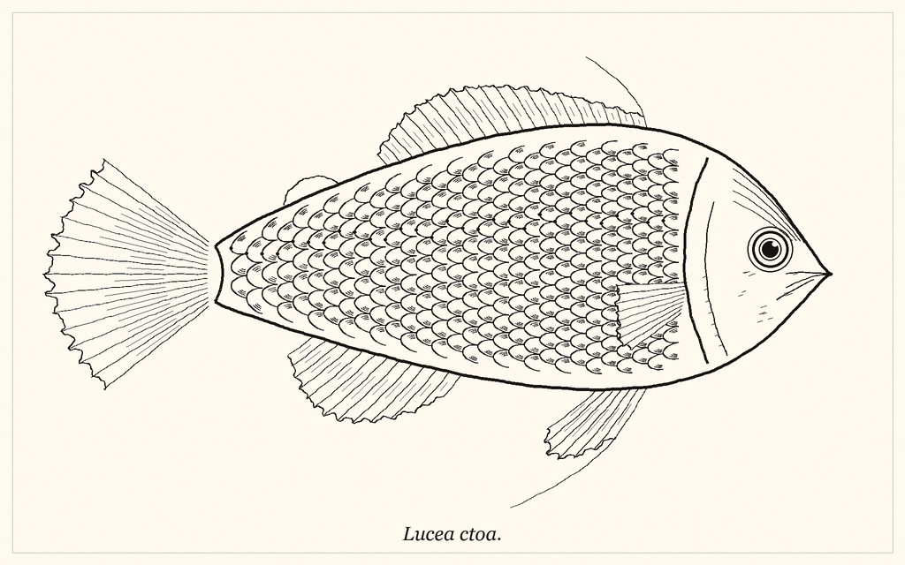
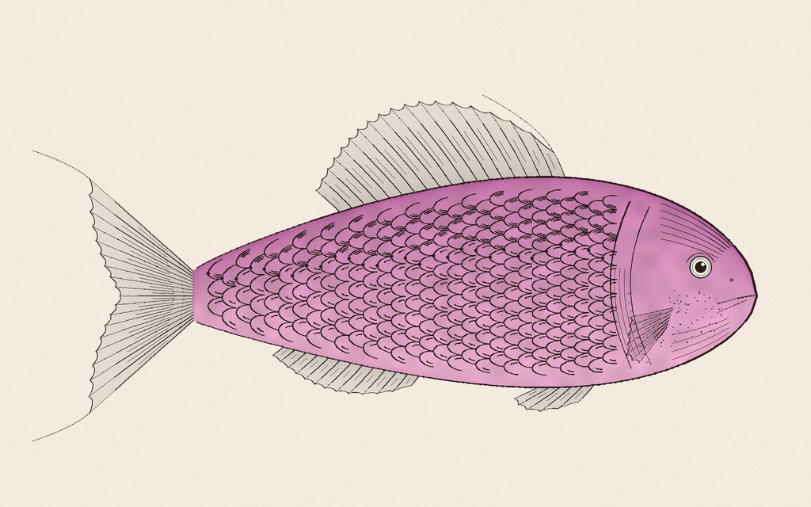
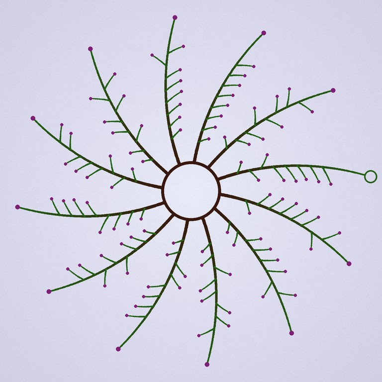

# Koi Pond

Procedural art that carries a machine-readable message. A pond of six engraved koi hides up to
85 bytes of text in its scales. A phone camera reads it back, and it still looks like a drawing
rather than a barcode.

<p align="center"></p>

Earlier formats from the same project, each carrying its own payload:

<p align="center">
  
  
  
</p>
<p align="center"><sub>Engraved fish (24 bytes) · watercolour fish (24 bytes) · topological coral (8 bytes)</sub></p>

## How it works

- **One bit per scale.** Each koi's body is a grid of scales, and each scale has a small group of
  hatch strokes on either its dorsal or ventral side. That side is the bit (176 per koi).
- **The bold outline is the sync mark.** The decoder reads the value channel (max of R, G, B), where
  the pale washes vanish, erases thin strokes with a grayscale opening, and finds each koi as a
  bold-outlined silhouette. It fits a curved spine, unbends the body along it, then tracks a
  bit-free scale-arc template column by column to read each hatch side.
- **Two layers of Reed-Solomon.** The 85-byte message gets 17 outer parity bytes and the codeword is
  dealt round-robin across the six koi, so a whole koi can be lost. Each koi also has an inner
  RS(4) code with an index byte, which tells the decoder which chunk it holds and whether it was
  read mirrored. A koi that fails its inner code becomes erasures for the outer code.

## Layout

| Path | What's there |
| --- | --- |
| `research/` | Python reference implementation and experiments |
| `research/koi.py` | The koi pond codec. This is the format reference the app follows |
| `research/harness.py` | Benchmark: payload → RS → render → distort → decode |
| `research/topo.py`, `fish.py`, `fish_wash.py` | Earlier formats: topological coral, a single engraved fish (fishdraw style), and a watercolour fish |
| `research/nn/`, `fish_nn*.py` | Learned decoders (see below), with weights in Git LFS |
| `android/` | Native Kotlin app: generator plus live-camera scanner |
| `design/index.html` | The app's UI design |

## Research code

```bash
cd research
pip install -r requirements.txt
python koi.py                    # round-trip self-check on one pond
python harness.py koi --n 12     # full benchmark, writes out/koi/
```

`harness.py` takes any method module (`topo`, `fish`, `fish_wash`, `koi`, `koi_nn`, `fish_nn`, `fish_nn2`)
and `--only jpeg blur ...` to run a subset of distortions.

Koi pond benchmark (12 ponds, fraction decoded exactly). "Classical" is `koi.py`'s own reader;
"learned" is `koi_nn.py`, the same front end with the strip reader described below.

| Distortion | Classical | Learned |
| --- | --- | --- |
| none | 1.00 | 1.00 |
| scale 0.75 / 0.5 / 0.35 | 1.00 / 0.92 / 0.00 | 1.00 / 1.00 / 0.92 |
| rotate 15° / 45° / 135° | 1.00 / 1.00 / 1.00 | 1.00 / 1.00 / 1.00 |
| JPEG q75 / 50 / 25 / 10 | 1.00 / 1.00 / 1.00 / 1.00 | 1.00 / 1.00 / 1.00 / 1.00 |
| blur σ1 / 2 / 3 | 1.00 / 1.00 / 0.42 | 1.00 / 1.00 / 0.92 |
| noise 8 / 16 / 32 | 1.00 / 1.00 / 1.00 | 1.00 / 1.00 / 1.00 |
| perspective 0.05 / 0.1 / 0.2 | 1.00 / 0.92 / 0.25 | 1.00 / 1.00 / 0.50 |
| lighting 0.3 / 0.5 / 0.7 | 1.00 / 1.00 / 1.00 | 1.00 / 1.00 / 1.00 |
| crop 5% / 10% / 20% | 1.00 / 1.00 / 0.08 | 1.00 / 1.00 / 0.08 |
| simulated phone photo 1 / 2 / 3 | 1.00 / 0.42 / 0.00 | 1.00 / 0.83 / 0.25 |

A 20% crop usually cuts two or more koi out of frame, which no reader can recover (the outer code
survives losing one).

## Learned decoders

### Koi pond strip reader

`koi_nn.py` keeps the classical front end (find each koi's silhouette, fit its spine, pick the head
end), unbends each koi into a 128×640 strip, and reads the strip with a v2-style BitReader (176 bit
queries, 2.95M params, `nn/koinn.pt`).

- **Data** (`nn/koi_data.py`): 3,000 ponds, each photographed 6 times through a random known warp
  (any rotation, down to 0.3 scale, perspective, crop) and lighting, blur, noise and JPEG. The
  classical front end runs on every view exactly as at decode time, and each koi it finds is
  labelled with its true bits by mapping the true nose and tail through the warp: 86k strips.
- **Training** (`nn/train_koi.py`): 40k steps at batch 128 on a Colab TPU v6e (Colab's `torch_tpu`,
  `torch.compile(backend='tpu')`, about 0.08 s/step). It starts on mildly damaged views only:
  thrown in at full difficulty, it settled on the constant header bits and never found the hatches.
- **Finishing** (`nn/koi_eval.py`): the compiled TPU graph never writes BatchNorm's running stats
  back, so they're recomputed eagerly before export.

On 2,911 held-out strips from photographed views, the fraction of koi fully decoded (inner RS passes):

| Photo severity | Learned | Classical |
| --- | --- | --- |
| mild (0–0.4) | 1.000 | 0.957 |
| medium (0.4–0.7) | 1.000 | 0.612 |
| harsh (0.7–1) | 0.940 | 0.280 |
| all | 0.981 | 0.619 |

The front end is now the weak link: on these views it finds only about 85% of the koi in frame.

### Single fish

- **v1** (`nn/train.py`, `fishnn.pt`): a CNN that reads the bits directly.
- **v2 BitReader** (`nn/train2.py`, `fishnn2.pt`): an FPN backbone onto a 50×80 grid, then 248
  learned bit queries in a 3-layer transformer decoder (2.96M params). It was trained on 30k
  rendered fish for 40k steps on an A100. `nn/viz2.py` and `nn/layers2.py` show what each layer
  attends to. Layer 1 mostly looks at its own scale.

Benchmark of the earlier formats, as the fraction decoded exactly. The fish columns use the same
30 fish (24-byte payload + 7 parity bytes). "Classical" is `fish.py`'s template-tracking reader,
and the watercolour fish uses its own renders with that same reader. The coral is 40 renders
carrying 8 bytes + 4 parity bytes, so it has a much easier job.

| Distortion | Coral | Classical fish | Watercolour fish | v1 CNN | v2 BitReader |
| --- | --- | --- | --- | --- | --- |
| none | 1.00 | 1.00 | 1.00 | 0.00 | 1.00 |
| scale 0.5 / 0.35 | 1.00 / 1.00 | 1.00 / 0.93 | 1.00 / 0.87 | 0.00 / 0.00 | 1.00 / 1.00 |
| rotate 15° / 45° / 135° | 1.00 / 1.00 / 1.00 | 1.00 / 1.00 / 1.00 | 1.00 / 1.00 / 1.00 | 0.00 / 0.00 / 0.00 | 0.97 / 0.00 / 0.00 |
| JPEG q25 / 10 | 1.00 / 1.00 | 1.00 / 1.00 | 1.00 / 0.87 | 0.00 / 0.00 | 1.00 / 1.00 |
| blur σ2 / 3 | 1.00 / 0.83 | 1.00 / 0.83 | 1.00 / 0.50 | 0.00 / 0.00 | 1.00 / 1.00 |
| noise 16 / 32 | 1.00 / 1.00 | 1.00 / 1.00 | 0.97 / 0.47 | 0.00 / 0.00 | 1.00 / 1.00 |
| perspective 0.05 / 0.1 / 0.2 | 1.00 / 1.00 / 1.00 | 0.97 / 0.53 / 0.00 | 0.97 / 0.47 / 0.00 | 0.00 / 0.00 / 0.00 | 1.00 / 1.00 / 0.97 |
| lighting 0.5 / 0.7 | 1.00 / 1.00 | 1.00 / 1.00 | 0.97 / 0.73 | 0.00 / 0.00 | 1.00 / 1.00 |
| crop 10% / 20% | 0.50 / 0.15 | 0.80 / 0.50 | 0.70 / 0.50 | 0.00 / 0.00 | 1.00 / 0.40 |
| simulated phone photo 1 / 2 / 3 | 1.00 / 1.00 / 0.85 | 1.00 / 0.80 / 0.17 | 1.00 / 0.73 / 0.00 | 0.00 / 0.00 / 0.00 | 1.00 / 0.90 / 0.03 |

v1 never decodes a whole fish: its bit error rate sits around 12%, more than the 7 parity bytes
can fix. v2 gets about 0.4% (roughly one bit per fish) on almost everything and beats the
classical fish reader on perspective, blur and crop. It fails at 45° and beyond, because training only
rotated the fish by up to ±30°.

`nn/gen_data.py` renders the training set. The training scripts default to Colab's `/content` paths.
The training data (`research/data/`) and renders (`research/out/`) are not in git; they regenerate
from the scripts.

## Android app

Kotlin and Jetpack Compose, minSdk 29. It's a port of `koi.py` that writes and reads the same
format both ways (the unit tests check against fixtures that the Python code wrote).

```bash
cd android
./gradlew :app:assembleRelease     # app/build/outputs/apk/release/app-release.apk
./gradlew :app:testDebugUnitTest
```

- **Create:** type a message, release the koi. The app draws the pond, reads it back, and redraws
  in a new style if any koi misreads.
- **Scan:** point the camera at a pond. It reads continuously and shows each koi as it's found.
- **History:** past ponds drift down a river.
- Share, save to Photos, or copy the image, plus Still water / Night pond themes.

Clone with [Git LFS](https://git-lfs.com) installed to get the model weights.
