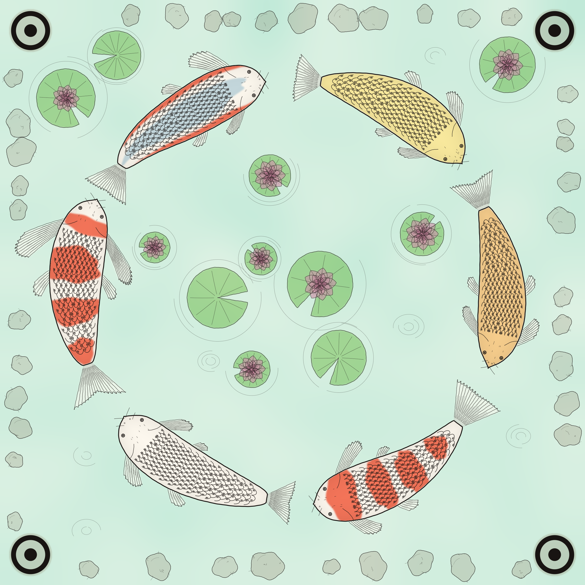

# Koi Pond

Procedural art that carries a machine-readable message. A pond of six engraved koi hides up to
85 bytes of text in its scales. A phone camera reads it back, and it still looks like a drawing
rather than a barcode.

<p align="center"></p>

## How it works

- **One bit per scale.** Each koi's body is a grid of scales, and each scale has a small group of
  hatch strokes on either its dorsal or ventral side. That side is the bit (176 per koi).
- **The bold outline is the sync mark.** The decoder reads the value channel (max of R, G, B), where
  the pale washes vanish, erases thin strokes with a grayscale opening, and finds each koi as a
  bold-outlined silhouette. It fits a curved spine, unbends the body along it, then tracks a
  bit-free scale-arc template column by column to read each hatch side.
- **Two layers of Reed-Solomon.** The 85-byte message gets 17 outer parity bytes and the codeword is
  dealt round-robin across the six koi, so a whole koi can be lost. Each koi also has an inner
  RS(4) code with an index byte, which tells the decoder which chunk it holds and whether it was
  read mirrored. A koi that fails its inner code becomes erasures for the outer code.

## Layout

| Path | What's there |
| --- | --- |
| `research/` | Python reference implementation and experiments |
| `research/koi.py` | The koi pond codec. This is the format reference the app follows |
| `research/harness.py` | Benchmark: payload → RS → render → distort → decode |
| `research/topo.py`, `fish.py`, `fish_wash.py` | Earlier formats: topological coral, a single engraved fish (fishdraw style), and a watercolour fish |
| `research/nn/`, `fish_nn*.py` | Learned decoders (see below), with weights in Git LFS |
| `android/` | Native Kotlin app: generator plus live-camera scanner |
| `design/index.html` | The app's UI design |

## Research code

```bash
cd research
pip install -r requirements.txt
python koi.py                    # round-trip self-check on one pond
python harness.py koi --n 12     # full benchmark, writes out/koi/
```

`harness.py` takes any method module (`topo`, `fish`, `fish_wash`, `koi`, `fish_nn`, `fish_nn2`)
and `--only jpeg blur ...` to run a subset of distortions.

Koi pond benchmark (12 ponds, fraction decoded exactly):

| Distortion | Levels → exact |
| --- | --- |
| none | 1.00 |
| scale 0.75 / 0.5 / 0.35 | 1.00 / 1.00 / 0.00 |
| rotate 15° / 45° / 135° | 1.00 / 1.00 / 1.00 |
| JPEG q75 / 50 / 25 / 10 | 1.00 / 1.00 / 1.00 / 1.00 |
| blur σ1 / 2 / 3 | 1.00 / 0.92 / 0.17 |
| noise 8 / 16 / 32 | 1.00 / 1.00 / 1.00 |
| perspective 0.05 / 0.1 / 0.2 | 1.00 / 0.92 / 0.17 |
| lighting 0.3 / 0.5 / 0.7 | 1.00 / 1.00 / 1.00 |
| crop 5% / 10% / 20% | 1.00 / 1.00 / 0.08 |
| simulated phone photo 1 / 2 / 3 | 1.00 / 0.25 / 0.00 |

## Learned decoders

These were trained on the single-fish format (`fish.py`), not the pond yet.

- **v1** (`nn/train.py`, `fishnn.pt`): a CNN that reads the bits directly.
- **v2 BitReader** (`nn/train2.py`, `fishnn2.pt`): an FPN backbone onto a 50×80 grid, then 248
  learned bit queries in a 3-layer transformer decoder (2.96M params). It was trained on 30k
  rendered fish for 40k steps on an A100. `nn/viz2.py` and `nn/layers2.py` show what each layer
  attends to. Layer 1 mostly looks at its own scale.

`nn/gen_data.py` renders the training set. The training scripts default to Colab's `/content` paths.
The training data (`research/data/`) and renders (`research/out/`) are not in git; they regenerate
from the scripts.

Next up is a pond reader: classical koi detection and spine fitting, then unbend each koi into a
strip and read it with a v2-style model.

## Android app

Kotlin and Jetpack Compose, minSdk 29. It's a port of `koi.py` that writes and reads the same
format both ways (the unit tests check against fixtures that the Python code wrote).

```bash
cd android
./gradlew :app:assembleRelease     # app/build/outputs/apk/release/app-release.apk
./gradlew :app:testDebugUnitTest
```

- **Create:** type a message, release the koi. The app draws the pond, reads it back, and redraws
  in a new style if any koi misreads.
- **Scan:** point the camera at a pond. It reads continuously and shows each koi as it's found.
- **History:** past ponds drift down a river.
- Share, save to Photos, or copy the image, plus Still water / Night pond themes.

Clone with [Git LFS](https://git-lfs.com) installed to get the model weights.
